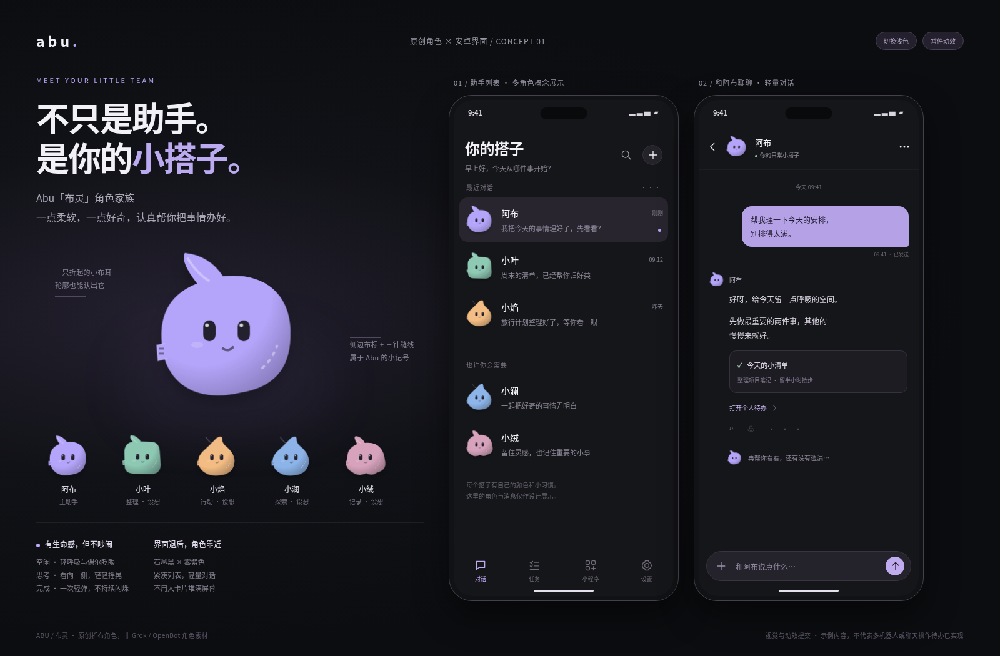
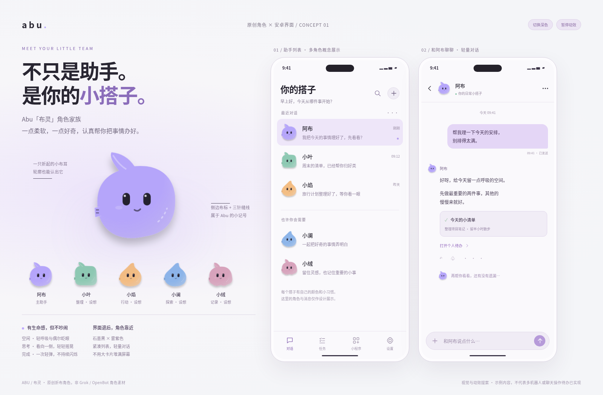

# Abu · 个人智能助手

安卓优先、Go 后端的个人助手，目标支持多个机器人、长期记忆、后台任务及 AI 创建的 APP 内小程序。

## 产品设计

这是已确认的目标视觉设计稿，不是 APP 实拍。布灵是 Abu 原创折布角色；稿中的其他角色和示例消息仅用于概念展示，实际版本目前只有主助手阿布。

[](docs/assets/abu-design-dark.png)

<details>
<summary>查看浅色设计稿</summary>

[](docs/assets/abu-design-light.png)

</details>

## 当前进展
- 安卓采用与 Daily 一致的 Kotlin Multiplatform + Compose、app/shared 分层。
- 原生 Compose 采用布灵深浅主题，设置可跟随系统或固定浅色／深色。对话、任务、小程序、设置使用四项底栏。新版视觉已实现，设备验证状态见安卓文档。
- 已实现单会话文字保存、历史读取、开发令牌鉴权与幂等提交。
- 已接通 group/deepseek-flash-4.1 的真实文本回复、回复持久化、失败状态及明确重试。
- 已在获准模拟器验证实际发送/回复展示，以及 Go 和 APP 重启后的历史恢复。
- 安卓任务页可创建单次文本任务、刷新记录、查看结果、取消或重新执行。关闭 APP 后由仍在运行的 Go 后台继续处理，重开后重新应用开发令牌即可读取已保存任务。
- 后台任务端到端已通过独立验收。安卓小程序目录已接入内置个人待办：联网可新增、编辑、勾选和删除，离线可查看上次确认的快照，也可切换已缓存的页面版本。旧版固定待办（v1/v2）已在 Android 16（API 36）通过独立验收。v3 随原生主题切换深浅，v1/v2 保留原资源与数据；本次布灵界面与 v3 已在 Android 16（API 36）、WebView 133 通过独立设备和视觉验收；结论仅涵盖固定可信待办，不代表任意生成脚本或生产发布能力。
- 多机器人、长期记忆、账号连接和生产设备配对均未实现。

## 文档
- [产品与架构](docs/product.md)
- [开发路线](docs/roadmap.md)
- [开发记录与协议](docs/development-chat.md)
- [模型配置与运行](docs/model-adapter.md)
- [安卓构建与验证](android/README.md)
- [固定待办开发协议与 WebView 实验](miniapps/README.md)

## Go 开发
需要 Go 1.26 或更新版本；仅标准库。
```sh
cd backend
go test -race ./...
go vet ./...
go run ./cmd/abu
```
默认只开放健康检查：GET http://127.0.0.1:8080/healthz。
启用聊天、后台任务及小程序 API 须设置独立 ABU_DEV_TOKEN；启用真实模型再传入 -model-env "$HOME/.config/abu/model.env"。
模型文件不会自动加载，不要把 API Key 当作安卓开发令牌。详见模型配置文档。

当前服务只监听 127.0.0.1:8080，通过 adb reverse 用于本机开发；没有公开部署或生产 HTTPS 配对。
本地开发记录位于 data/，生产数据库尚未接入。
APK：android/app/build/outputs/apk/debug/app-debug.apk。
